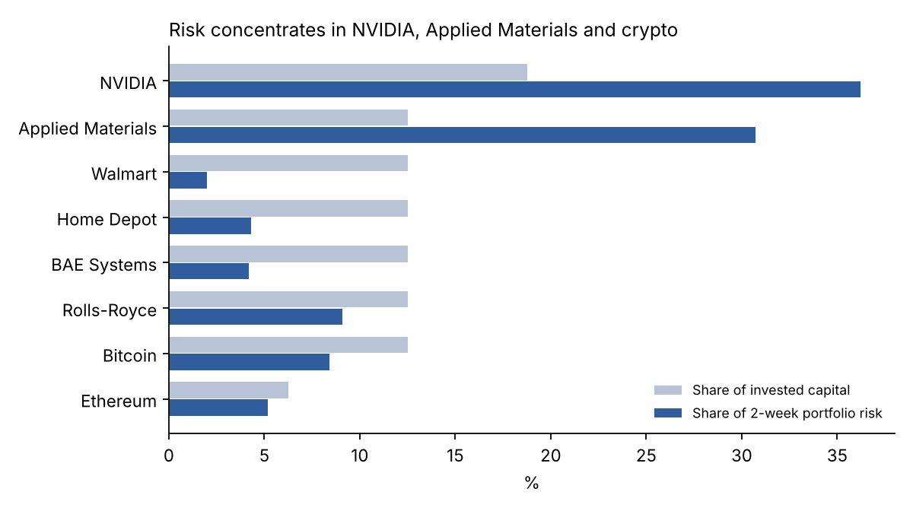

# Quantitative Finance Portfolio

**Varrun Satheeshkumar** · Mathematics and Economics, University of Nottingham; conditional offer for the MSci Mathematics with Statistics at Bristol from 2027 (expected graduation 2030) · applying for quantitative trading roles · [LinkedIn](https://linkedin.com/in/varrun-satheeshkumar-968832264)

Independent work alongside first-year studies: two research programmes on market data (BTC liquidation flow; futures trend, carry and value), a live investment-competition risk model, a scored machine-learning competition entry, and foundations in pricing, optimisation and econometrics.

Neither research programme found a tradable edge, and that is reported as such. Each carries recorded hypotheses, a claim ledger with published corrections, and a reproduction record; the limitations of each evaluation are listed at the top of its write-up.

## Selected work

| Project | Question | Method | Result |
| --- | --- | --- | --- |
| **P9 — UMushroom event risk** (Nov 2026, live) | Where does a two-week event-driven portfolio's risk sit, and how should it be sized? | Ledoit–Wolf covariance on six months of sterling returns plus options-implied earnings jumps; Euler risk contributions; equal-risk comparison | Four risk-on positions are 40% of capital and 80% of modelled two-week risk; a halfway rebalance to equal risk cuts that to 68%. Model, data cutoff, weights and call ledger were fixed before the 9–20 Nov window; scored once by the competition on 22 Nov. [Model and results](p9_umushroom_event_risk/) |
| **P7 — BTC forced flow and volatility** | Does price respond to inferred liquidation levels? Do map-derived features improve volatility forecasts? | Liquidation map from open interest, price and funding; five framings with recorded hypotheses; ridge volatility model against GARCH and HAR-RV | Continuation after unpredicted prints is −0.3 [−4.8, 4.0] bps at 30 minutes, inside a ±10 bps cost band. A model including map features has higher point R² than HAR-RV but worse QLIKE in three of four sealed cells; the features' contribution is unresolved. [Write-up](btc-public/WRITEUP.md) · [Known limitations](btc-public/WRITEUP.md#known-limitations) |
| **P8 — Futures trend, carry and value** | How do the three signals perform after modelled costs, and does a candidate screen find anything? | Costs projected before any signal was evaluated (edge/cost 2.3); signals specified in advance across 13–27 markets; sealed hold-out; recorded candidate screen | Training net Sharpes 0.24 / 0.08 / −0.44, combined 0.06; hold-out −1.28 on a period upstream steps had read. Programme stopped. Crypto funding candidate C18: gross alpha +1.0%/week (t 3.7), net alpha unresolved. [Write-up](futures-public/WRITEUP.md) · [Known limitations](futures-public/WRITEUP.md#known-limitations) |
| **P6 — QRT × ENS Data Challenge** | Predict the sign of an allocation's next-day return | LightGBM and CatBoost variants with a Set Transformer across each day's allocations; equal-weight ensemble | **178 / 1,175 public** (May 2026), **210 / 1,280 private** (June 2026); accuracy 0.5212 against the official baseline of 0.5079. Code withheld while the challenge runs. [Method and dated results](p6_qrt_challenge/) |

## Research results and judgement

### P9 — Measuring risk before the window

The brief said the portfolio was "40% risk-on". With correlations and earnings jumps included, those four positions carried 80% of modelled risk, and Walmart's 10% of capital carried 2%. The decision was a halfway rebalance to equal risk, keeping every catalyst, costing about £500–800 of modelled upside in a strong fortnight. The result holds without shrinkage, with past event days kept in, and with the UK jump sizes set to 0% or 5%. Every figure is a model output; the competition's scoring on 22 Nov is the realised result, and a post-mortem will be added then.

→ [Model, ledger and outputs](p9_umushroom_event_risk/) · [Rebalance comparison](p9_umushroom_event_risk/README.md#rebalance-halfway-to-equal-risk-comparepy)

### P8 — From signals to a costed portfolio

Across 13–27 futures markets, the training net Sharpes are **0.24 trend, 0.08 carry, −0.44 value and 0.06 combined**, without computed intervals; the hold-out net Sharpe is −1.28 on a period that roll-switch selection and cost normalisation had read. The crypto funding candidate C18 reports **gross alpha +1.015%/week** (month-block SE 0.27, t 3.73); its net alpha is uncomputed and the universe is survivor-conditioned. There were two departures from the registered stopping rules; [the write-up records both](futures-public/WRITEUP.md#known-limitations).

**Decision:** stop the futures programme and keep C18 unresolved. In future, stop when a registered halt fires and label any further work as a separate exploratory continuation.

→ [Check one portfolio week by hand](futures-public/WRITEUP.md#worked-example-constructing-one-c18-week) · [Code and running instructions](futures-public/) · [Full write-up](futures-public/WRITEUP.md)

### P7 — From a liquidation map to measured outcomes

Continuation after unpredicted prints at 30 minutes is **−0.3 [−4.8, 4.0] bps** at the print unit with a day-block bootstrap; the [three-horizon table](btc-public/WRITEUP.md#price-after-liquidation-prints) has the 15- and 60-minute estimates. The model including map-derived features has point R² differences of **+0.024/+0.026/+0.038/+0.051** over the hour/day/week HAR benchmark, without computed uncertainty, and the intraday HAR has lower QLIKE in three of four sealed cells; no ablation isolates the features.

**Decision:** keep the measurements, leave forecast attribution unresolved, and withdraw the option-economics conclusions. In future, specify cost assumptions and the effect worth finding before searching for signals; P8's cost screen and P9's frozen protocol are the two steps taken since.

→ [Check one cluster touch by hand](btc-public/WRITEUP.md#one-touch-from-map-state-to-measurement) · [Code and running instructions](btc-public/) · [Full write-up](btc-public/WRITEUP.md)

## Foundations

- **[P1 — Options pricing](p1_black_scholes/):** European pricing, five Greeks, Newton–Raphson implied volatility and a CRR binomial tree; tree/formula comparisons and stylised volatility-skew inputs.
- **[P2 — Portfolio optimisation](p2_markowitz/):** efficient frontiers and weight sensitivity across simulated estimation windows. Covariance shrinkage does not resolve uncertainty in expected returns.
- **[P3 — UK macro regressions](p3_econometrics/):** OLS from the normal equations and residual diagnostics. Dependence limits inference; the later subsample of the 2022 split has only two observations.
- **[P4 — JustWalk investment model](p4_justwalk/):** unit economics, DCF and a Monte Carlo footfall simulation for a company I founded, which secured £50,000 and installed tiles at Vodafone's Paddington office. The office model yields about £2/year in electricity revenue; the positive hub scenario depends on assumed SaaS revenue.
- **[P5 — UK gilt crisis](p5_market_report/market_insight_report.md):** an interpretive report on the fiscal announcement, LDI leverage and pre-existing market fragility; no separately identified causal estimate.

## Evidence and reproduction

P7 and P8 demonstrate research construction and inference practice; neither establishes a tradable strategy, and neither records live execution or inventory management. Both were audited against a [claim ledger](audit/CLAIM_LEDGER.md) that records sources, qualifications and withdrawn wording; the corrections are [published in full](audit/CORRECTIONS.md). The [audit guide](audit/README.md) describes the ledger's scope (a spot check, not a certification of every sentence) and the private-source limitations, and the [reproduction record](audit/REPRODUCTION.md) distinguishes regenerated outputs from retained historical reports.

P9 is the first project run under a frozen prospective protocol; its post-mortem after 22 Nov will be held to the same ledger standard.

Build dates: P1–P6 spring 2026, P7–P8 September 2026, P9 November 2026. Methods, dependencies and available outputs are documented within each project.

## Index

| | Project | Folder |
| --- | --- | --- |
| P1 | Options pricing | `p1_black_scholes/` |
| P2 | Portfolio optimisation | `p2_markowitz/` |
| P3 | UK macro regressions | `p3_econometrics/` |
| P4 | JustWalk investment model | `p4_justwalk/` |
| P5 | UK gilt crisis report | `p5_market_report/` |
| P6 | QRT × ENS Data Challenge | `p6_qrt_challenge/` |
| P7 | BTC forced flow and volatility | `btc-public/` |
| P8 | Futures trend, carry and value | `futures-public/` |
| P9 | UMushroom event risk | `p9_umushroom_event_risk/` |
